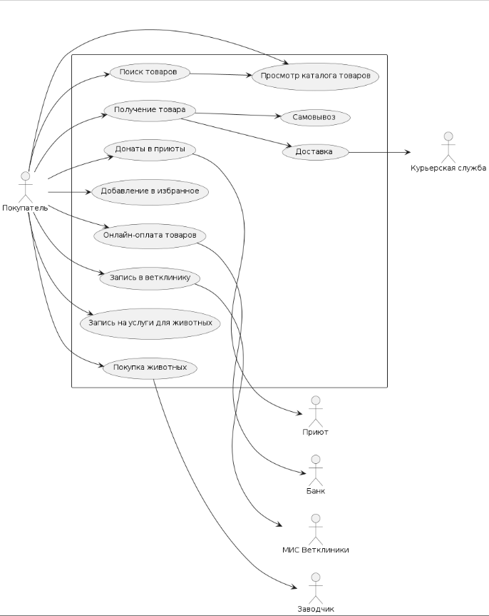

# ZooMarket

Интернет-магазин зоотоваров и будущая платформа зоо-услуг для сети «Зоология».

## О проекте

ZooMarket — интернет-магазин зоотоваров, который развивается на базе действующей сети магазинов «Зоология». Сегодня сеть насчитывает 20 магазинов в пяти крупных городах Дальнего Востока. Компания уже полгода продаёт товары через соцсети и мессенджеры и накопила клиентскую базу в 1500 человек. С этой базой запускается маркетплейс.

Цель проекта — начать с продажи товаров для животных и постепенно вырасти в полноценную платформу зоо-услуг. Через два года планируется выход на Центральную Россию; пока компания ориентируется на Дальний Восток.

Инвестор — Маша Собачкина, имеет большой опыт вывода маркетплейсов на рынок. Бюджет на горизонте двух лет — 15–20 млн рублей.

## Функционал

### MVP (0–3 месяца)

- Продажа еды для животных
- Продажа сопутствующих товаров (поводки, шлейки и т. д.)

### Этап 2 (3–6 месяцев)

- Донаты для приютов: раз в месяц деньги перечисляются на выбранный приют
- Продажа породистых животных от заводчиков (кошки и собаки) — объявления о продаже

### Этап 3 (около 1 года)

- Запись в партнёрские ветеринарные клиники

### Этап 4 (около 1,5 лет)

- Услуги для животных (стрижка, выгул)

### Полный функционал — 2 года

## Технические требования

**Платформа:** веб-сайт.

**Оплата:** только онлайн-оплата.

**Доставка:** интеграция с курьерской службой; доступен самовывоз из магазина или доставка курьером.

**Интеграция с 1С:** у сети 20 магазинов с 1С — необходимо выгружать каталог товаров из 1С.

**Уведомления:** push- и SMS-рассылки.

**Система лояльности:** накопительные скидки и другие механики.

**Идентификация клиента:** по номеру телефона.

**Рекомендательная система:** фиксируются действия покупателя (покупки, лайки) и на их основе формируются рекомендации.

**Инфраструктура:** собственных мощностей для поддержки сайта нет — планируется размещение в облаке.

**Нефункциональные требования:** масштабируемость, надёжность.

## Дорожная карта

| Срок | Функционал |
|------|-----------|
| 0–3 месяца | Продажа товаров для животных |
| 3–6 месяцев | Донаты в приюты, продажа щенков и котят |
| ~1 год | Запись в ветеринарные клиники |
| ~1,5 года | Услуги для животных |
| 2 года | Полный функционал; выход на Центральную Россию |

# Диаграмма вариантов использования

